# Create Environment Module

## Overview
Create or repair a custom `EnvBase` environment module under `custom/envs`. Guides requirements intake through validation, producing a single `.py` file with properly decorated tools.

## When to Use
- User asks to create a new environment or simulation module (e.g. "social media module", "voting environment", "market simulation")
- `experiment-config` needs an environment module that does not yet exist in the workspace
- User wants to add or modify `@tool`-decorated methods on an existing custom env
- The simulation scale, step budget, or runtime budget should influence the module design

**Do NOT use when:**
- The env module already exists and only needs registration (use `scan-modules` instead)
- The task is about agent skills, not environment modules

## Workflow

```dot
digraph create_env_flow {
    rankdir=LR;
    node [shape=box, style=filled, fillcolor="#E8F4FD"];
    intake [label="collect requirements"];
    clarify [label="clarify missing\nconstraints"];
    design [label="structured design"];
    generate [label="write custom/envs/<module>.py"];
    validate [label="run create-env-module-validate"];
    archive [label="optional run artifacts"];

    intake -> clarify -> design -> generate -> validate -> archive;
}
```

## Stage Notes

- `stages/intake.md`: requirements intake
- `stages/clarify.md`: resolve missing constraints
- `stages/design.md`: structured design
- `stages/generate.md`: code generation
- `stages/validate.md`: validation and failure mapping

## Scale Budget

Collect the simulation scale budget before locking the module design:

- target agent count or range
- expected step budget
- runtime or compute budget
- preferred complexity tier, such as lean, balanced, or rich

If the scale budget is missing, ask a single round of clarifying questions. Present 2-3 approaches with trade-offs and a recommendation, then choose the one that keeps tool cost and state size proportional to the simulation size.

## Shared References
- Compatibility contract: `checklists/compatibility.md`
- **Common pitfalls (read before writing tool bodies): `references/pitfalls.md`**
- Artifact schema: `artifacts/schema.md`
- Persistence patterns: `references/persistence-patterns.md`
- Runtime source guide: `references/runtime-sources.md`
- Runtime source resolver: `$PYTHON_PATH .agentsociety/bin/ags.py create-env-module-resolve-sources`
- Validation CLI: `$PYTHON_PATH .agentsociety/bin/ags.py create-env-module-validate` (flags: `--file`, `--workspace`, `--class-name`, `--run-id`, `--json`, `--no-refresh-metadata`)

## Runtime Contract
- Final generated env code must land in `custom/envs/*.py`.
- The class must be defined in that file directly and registered by its `class_name`.
- **Inherit ONLY from `EnvBase`. Never subclass an existing env module, a contrib module (e.g. `SocialMediaEnv`, `MobilitySpaceEnv`), or any other concrete/custom env class.** Copy and rewrite the logic you need from scratch, using those modules as *references* only. This is mandatory — see *No-Inheritance Rule* below.
- Do not invent a package-style output format for the generated environment.
- If the environment exposes tools agents must invoke, bundle an agent skill under `custom/envs/<module>_agent_skills/<skill>/SKILL.md`. That `SKILL.md` **must** start with YAML frontmatter declaring `name` + `description`, or agents will never discover it. See `stages/generate.md` → *Bundled Agent Skills*.
- Prefer validating through `.agentsociety/bin/ags.py create-env-module-validate`, and use run artifacts only when they add review value.

## No-Inheritance Rule (mandatory)

When you create or revise a module, the class **must inherit directly from `EnvBase`** — never from an existing environment class. If a contrib/custom module already does something similar, **read it as a reference and re-implement the methods yourself** in the new file; do **not** write `class MyModule(SomeExistingEnv)`.

**Why this is non-negotiable:** `EnvBase`'s metaclass (`EnvMeta`) discovers `@tool`-decorated methods by walking **only the class's own `namespace`** at class-creation time, and it **overwrites** `_registered_tools` on every subclass. Inherited `@tool` methods are therefore **never registered** on the subclass — every tool the new module was supposed to inherit silently disappears from the registry, and the env is effectively non-functional even though the code "looks fine". Re-declaring a tool with the same name in the subclass does not fix it either; rewrite the body. Full details: `references/pitfalls.md` P5.

Use the Python interpreter from `.env`. See `CLAUDE.md` for setup.

## Common Mistakes
| Mistake | Fix |
|---------|-----|
| Subclassing an existing env module / contrib class (`class MyEnv(SocialMediaEnv)`) to reuse its tools | Don't. The metaclass only collects `@tool` methods from the class's own namespace and overwrites the registry on subclasses, so all inherited tools silently vanish. Rewrite the methods yourself in the new file, inheriting ONLY from `EnvBase` — see `references/pitfalls.md` P5 |
| Creating package-style directory output (`__init__.py` + submodules) | Write a single `custom/envs/<module>.py` file |
| Skipping validation after code generation | Always run `.agentsociety/bin/ags.py create-env-module-validate` before finishing |
| Forgetting `@tool` decorator on environment methods | Every public method agents can call needs `@tool(readonly=...)` |
| Defining class in `__init__.py` instead of the module file | Define the class directly in `custom/envs/<module>.py` |
| `@tool` returning `bool` or `{"success": bool}` | Return a dict / Pydantic model with `status: str` ∈ `{success, fail, in_progress, error}` — see `references/pitfalls.md` P1 |
| `init_description` / tool docstrings phrase operations as Python call literals | Use prose with bold function names and parameter descriptions — see `references/pitfalls.md` P2 |
| `readonly=False` tool not idempotent within one step (counter `+= 1`, list `.append`) | Use last-write-wins, set-based dedup, or explicit dedup-key — see `references/pitfalls.md` P3 |
| 2+ write tools sharing argument names (`post_id` on both `read_post` and `share_post`) | Rename to distinct argument names or document the agent-side cache-collision mitigation — see `references/pitfalls.md` P4 |
| Bundled `agent_skills/<skill>/SKILL.md` missing YAML frontmatter or an empty `description` | Start `SKILL.md` with `---` frontmatter declaring `name` + `description`; without it the skill registers empty and agents never select it — see `stages/generate.md` → *Bundled Agent Skills* |

## Subagent Delegation

Stages 3-4 (design + code generation) are the most context-intensive steps. Delegate to subagents when:

- The env module has complex state persistence (replay tables via `_agent_state_columns` / `_env_state_columns` + `_write_*` helpers, agent state tracking)
- Multiple `@tool` methods with intricate parameter validation are needed
- The hypothesis requires specific env behaviors tied to experiment variables
- You are mid-pipeline and context is becoming a concern

**How to delegate (planner → generator → reviewer):**

1. Complete Stages 1-2 yourself (intake + clarification). Collect user requirements.
2. **Planner**: Dispatch a subagent with the user requirements + hypothesis context, instructing it to read `subagent-prompts/planner.md` and follow it. The planner produces a structured DesignSpec JSON — what tools to expose, what state to track, persistence classification for every variable, all tied to the hypothesis.
3. **Generator**: Dispatch a subagent with the DesignSpec, instructing it to read `subagent-prompts/implementer.md` and follow it. The generator writes code from the spec.
4. **Reviewer**: Dispatch a subagent with the file path + DesignSpec, instructing it to read `subagent-prompts/reviewer.md` and follow it. The reviewer checks the code against the spec with fresh context.
5. After all subagents return, run `$PYTHON_PATH .agentsociety/bin/ags.py create-env-module-validate ...` yourself and fix any remaining issues from the reviewer report.

**Do NOT delegate:** simple stateless env modules with 1-2 trivial tools. For those, do Stages 1-5 yourself.

## Pipeline Position
**Optional helpers:** `scan-modules` (to check existing envs before creating a new one)
**Successors:** `experiment-config` (when custom envs are needed)
**Called by:** `experiment-config` as an optional branch
