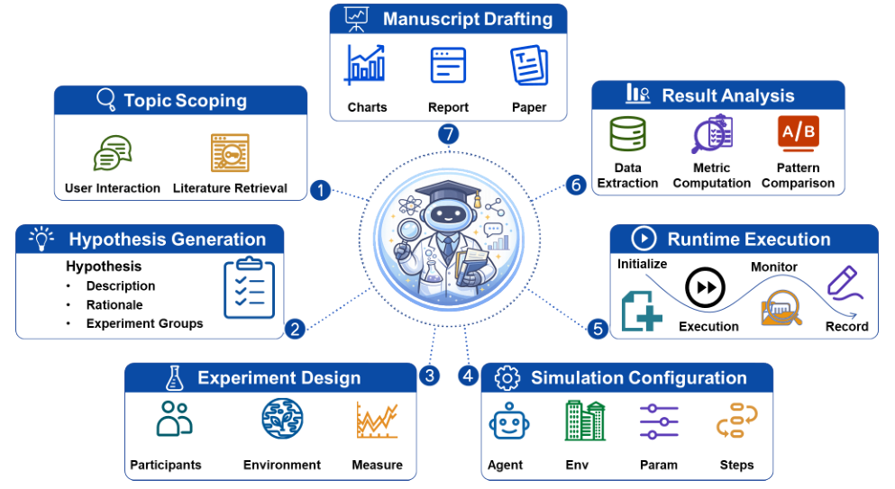

AI Social Scientist 使用指南
================================

**AI Social Scientist** 是 AgentSociety 2 的交互式研究助手，通过 VS Code 扩展提供模型配置、后端管理和研究项目入口。可以使用在线工作空间，也可以在本地安装。

首次使用时，先选择在线或本地入口，再完成模型与后端配置。项目初始化后，可以管理文献、技能、假设与实验，并查看分析报告。

   AI Social Scientist 的研究流程：从选题与假设推进到实验、分析和写作。图源：`AgentSociety 2 <https://arxiv.org/html/2607.11895v2#S4.F9>`_，`CC BY-NC-SA 4.0 <https://creativecommons.org/licenses/by-nc-sa/4.0/>`_。

按任务查找
----------

.. container:: guide-links

   .. raw:: html

      
      
      
      
      
      
      
      

   .. list-table::
      :widths: 40 60
      :header-rows: 1

      * - 任务
        - 阅读入口
      * - 使用平台提供的开发环境
        - :ref:`online-workspace`
      * - 安装 SDK、扩展与研究助手
        - :ref:`local-setup`
      * - 配置模型并启动后端
        - :ref:`env-config`
      * - 连接 Claude Code / Codex 的模型服务
        - :ref:`ai-gateway`
      * - 创建话题、管理文献与分享项目
        - :ref:`start-research`
      * - 使用技能、市场与 MCP
        - :ref:`workbench-skills`
      * - 查看回放、分析与报告
        - :ref:`workbench-results`
      * - 排查安装与运行问题
        - :ref:`user-guide-faq`

分步说明
--------

.. toctree::
   :maxdepth: 1

   user_guide/online-workspace
   user_guide/local-installation
   user_guide/configuration
   user_guide/cli-gateway
   user_guide/research-project
   user_guide/troubleshooting

研究设计的完整流程见 :doc:`research_workflow`；数据准备见 :doc:`datasets`；回放、分析阶段与报告见 :doc:`results`。
