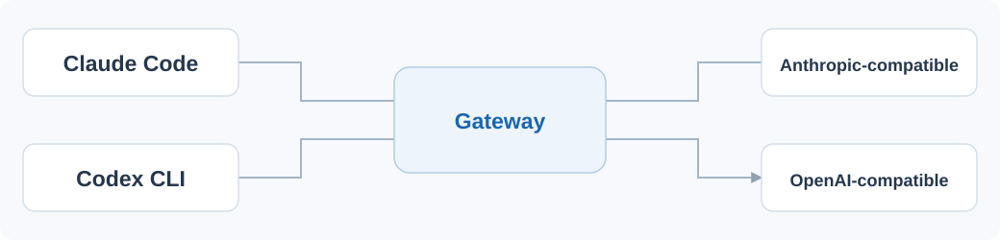

.. _ai-gateway:

CLI 网关配置
==============================

**AI Gateway** 是插件内置的本地 HTTP 代理，运行在 ``127.0.0.1:15721-15820`` 端口范围内。它拦截 Claude Code 和 Codex CLI 的 API 请求，将其转发到你配置的上游供应商，并自动完成协议格式转换与模型名映射。

网关按当前角色和供应商配置转发请求。添加服务前，请核对其接口协议与模型权限。请求流如下：

   本地 AI Gateway 请求流

从左向右读取：客户端请求进入本地 Gateway，再按当前供应商配置转发。仿真 LLM 的配置单独保存在工作区 ``.env``，不由这条 Claude / Codex 路由控制。

Gateway 对 Claude Code 始终呈现一个标准的 Anthropic Messages 端点（``/v1/messages``），对 Codex 始终呈现一个标准的 OpenAI Responses 端点（``/v1/responses``）。因此这两个 CLI 不需要知道背后其实是哪家供应商、哪种协议——Gateway 会在中间完成所有转换。

供应商与路由
--------------

Gateway 提供一个**共享供应商池**——供应商只保存一份，但可以在供应商卡片上分别「激活」到 Claude Code 或 Codex CLI 角色：

- **Anthropic 原生供应商** （如 ``api.anthropic.com``、DeepSeek 的 ``/anthropic`` 端点）：直接服务 Claude Code，请求直通转发。
- **OpenAI 兼容供应商** （如 ``api.openai.com``、智谱 ``paas/v4``、DeepSeek ``/v1``）：可同时服务 Claude Code 和 Codex CLI。
  - 服务 Claude Code 时，Gateway 会把 Claude Code 发出的 **Anthropic Messages** 请求实时翻译成 **OpenAI Chat Completions**，再把返回的 SSE 流翻译回去。
  - 服务 Codex CLI 时，Gateway 会把 Codex 发出的 **OpenAI Responses** 请求翻译成 **OpenAI Chat Completions**。

添加供应商时需要选择正确的接口类型：

- 若供应商提供 Anthropic Messages 协议（``/v1/messages``），选择 **Anthropic**。
- 若供应商只提供 OpenAI Chat 协议（``/v1/chat/completions``），选择 **OpenAI 兼容**。

内置预设已覆盖常见供应商（Anthropic、DeepSeek、智谱、Kimi、MiniMax、火山引擎、OpenRouter、阿里百炼、Moonshot、SiliconFlow 等），可直接选用。

协议格式转换
--------------

Gateway 在转发过程中会做以下转换，确保第三方模型的行为尽可能贴近原生体验：

- **请求方向**：``system`` 提示、``tools`` 工具定义、``tool_choice``、 ``thinking``（扩展思考，会映射为 ``reasoning_effort``）、``max_tokens`` 等都会按目标协议规范化。
- **响应方向**：第三方模型的 ``reasoning_content``（思考过程）会被翻译成 Anthropic 的 ``thinking`` 内容块；``tool_calls`` 会被翻译成 ``tool_use`` 内容块，保证 Claude Code 能正确识别工具调用（这是保证工具调用 / 多轮对话不中断的关键）。
- **模型名映射**：Claude Code 发出的 ``claude-sonnet-*`` / ``claude-opus-*`` / ``claude-haiku-*`` / ``claude-fable-*`` 会自动映射为供应商配置的对应角色模型；``[1M]`` 等本地能力标记会在转发前剥离，避免泄漏给供应商。

故障转移与用量统计
-------------------

- **故障转移**：可为 Claude 和 Codex 分别开启多供应商优先级，单点失败后自动切换到下一个候选供应商，并由断路器（circuit breaker）抑制反复失败的上游。切换成功后会更新活跃供应商，UI 会同步反映。
- **用量统计**：面板按天展示请求趋势，区分 Claude 与 Codex 来源，支持 7 天 / 30 天 / 全部 筛选。会分别统计输入、输出、缓存读取、缓存写入 token。
- **费用估算**：定价来源优先级为 **自定义 > 远程（OpenRouter / LiteLLM）> 内置**，远程定价 24 小时缓存。对 Codex / OpenAI 兼容记录，会先从可计费输入中扣除缓存命中再计费，缓存读取单独计价。
- **状态栏**：启用 Gateway 后，VS Code 状态栏会显示 Gateway 端口及路由状态（Claude / Codex / Claude + Codex），点击可打开后端状态菜单或回到配置页。

Gateway 排错
-------------

- **查看日志**：打开 ``AI CLI Gateway`` 输出通道，每行记录请求路径、上游地址、HTTP 状态码、耗时与模型名，形如 ``POST /v1/messages → 200 (4183ms) [deepseek-v4-pro] [https://...]``。
- 日志显示 ``in:0 out:0``：表示该次响应未提取到 token 用量，常见于流式响应提前中断或上游未返回 usage 字段。
- **请求中断 / 对话到一半停止**：通常是对话中触发了工具调用，但旧版本网关未正确翻译 ``tool_calls``。请确认使用的是已修复该问题的扩展版本。
- **403 key_model_access_denied**：上游拒绝该 API Key 访问请求的模型，说明模型名映射未生效或供应商未开通该模型权限，请在供应商卡片核对模型。
- **手动校验健康状态**：``curl http://127.0.0.1:<port>/health`` 应返回 ``{"ok": true, ...}``。
